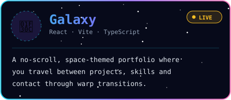
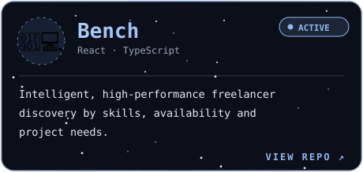
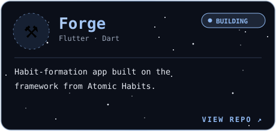
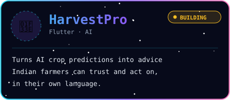
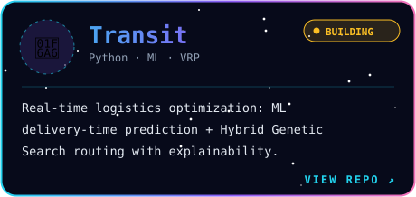
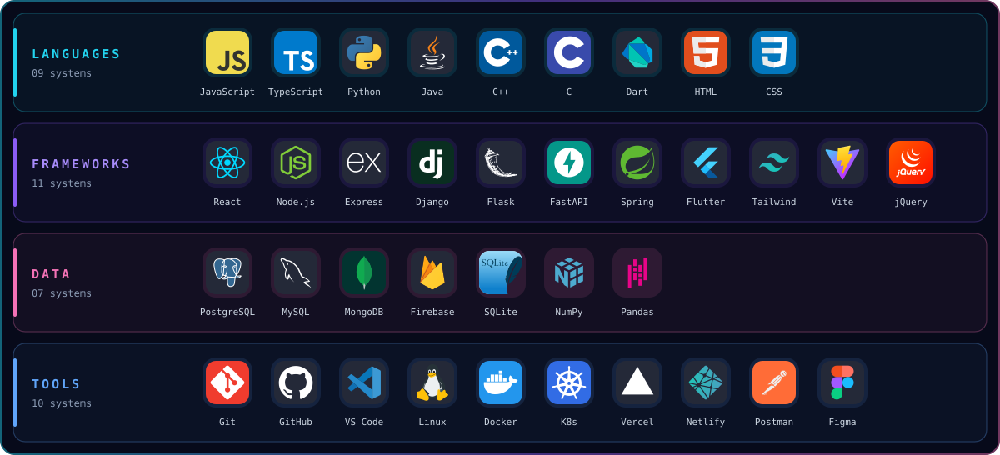

## 🛰️ Mission Briefing

## 🌌 Flagship

 

## 🪐 Missions Launched

## 🌠 Milestones

## 🧭 Navigation Systems

## 📡 Flight Data

 

## 🌌 Orbit Log

<picture>
  <source media="(prefers-color-scheme: dark)" srcset="https://raw.githubusercontent.com/Rishivardhan-J/Rishivardhan-J/output/github-contribution-grid-snake-dark.svg" />
  <source media="(prefers-color-scheme: light)" srcset="https://raw.githubusercontent.com/Rishivardhan-J/Rishivardhan-J/output/github-contribution-grid-snake.svg" />
  
</picture>

<b>🛸 More from the hangar</b>

 

- [Smart Hostel Management System](https://github.com/Rishivardhan-J/Smart_Hostel_Management_System)
- [DoctorV](https://github.com/Rishivardhan-J/DoctorV)
- [Mood-based Music Playlist Generator](https://github.com/Rishivardhan-J/Mood-based-Music-Playlist-Generator)
- [AI-Powered WorkLog & Productivity Tracker](https://github.com/Rishivardhan-J/AI-Powered-WorkLog-and-Productivity-Tracker)
- [Food Delivery App](https://github.com/Rishivardhan-J/Food_delivery_app)

## 💬 Transmission

*"A computer is a stupid machine with the ability to do incredibly smart things,*
*while computer programmers are smart people with the ability to do incredibly*
*stupid things. They are, in short, a perfect match."*

